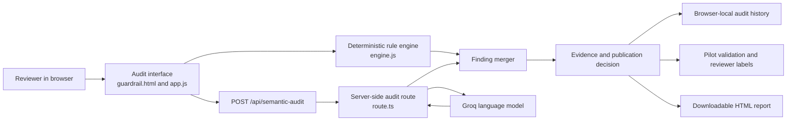

# SOP Sentinel

Interactive prototype for a multilingual SOP safety and localization auditor.

## Architecture



The application uses two complementary audit layers:

- **Browser interface:** `public/guardrail.html`, `public/styles.css`, and `public/app.js` collect the source and translated SOPs and present the combined result.
- **Deterministic engine:** `public/engine.js` checks numbers, units, durations, percentages, negations, protected terms, and procedural structure without an external API call.
- **Semantic API:** `app/api/semantic-audit/route.ts` sends meaning-level checks to Groq from the server. The API key remains in the server environment and is never delivered to the browser.
- **Result merger:** `public/app.js` combines rule-based and semantic findings into one evidence model with severity, excerpts, explanations, and suggested corrections.
- **Validation layer:** `public/evaluation.js`, `public/pilot-cases.js`, and `public/pilot.js` run labeled cases, record reviewer verdicts, and calculate recall, precision, and latency.
- **Local persistence:** Recent audits and reviewer labels stay in browser `localStorage`; the prototype does not store customer SOPs in a database.

### Request flow

1. The reviewer provides the original SOP and its translation.
2. The browser runs deterministic checks immediately.
3. The browser calls the semantic audit API for omissions, reversed meaning, unsafe simplification, and reordered dependencies.
4. The API returns structured JSON findings, which are merged with the deterministic result.
5. The UI blocks publication when critical findings exist and shows the exact evidence to a human reviewer.
6. If Groq is unavailable or rate-limited, the request fails safely and the deterministic findings remain visible.

## Run locally

Install dependencies and start the full-stack preview:

```powershell
npm install
npm run dev
```

The deterministic analysis runs in the browser. Semantic analysis runs through a server-side route so the Groq key is never exposed to visitors.

## Current behavior

- Paste or edit source and translated SOP text.
- Detect changed numbers, units, percentages, and durations.
- Detect missing safety negations.
- Check protected uppercase technical terms.
- Flag missing or additional procedural steps.
- Try pharma, manufacturing, and delivery examples.
- Copy the suggested correction.
- Mark the finding as resolved or dismissed.
- Save recent audits in browser-local history.
- Download a self-contained HTML audit report.
- Run an 18-case labeled deterministic regression benchmark.
- Explain the product rationale, architecture, pilot cost, and limitations in a built-in case study.
- Work through a 24-case pilot-style validation queue.
- Capture bilingual reviewer verdicts and calculate observed precision, recall, and latency.
- Download a two-week technical pilot brief and copy a reusable outreach note.

## Tests

```powershell
node tests/engine.test.mjs
node tests/evaluation.test.mjs
node tests/pilot.test.mjs
```

Phase 3 adds semantic comparison using Groq's free-plan `qwen/qwen3.8-27b` model. Failed or rate-limited AI calls fall back safely to deterministic findings.

## Local API configuration

Copy `.env.example` to `.env.local` and replace all placeholder values:

```text
GROQ_API_KEY=your_key_here
SITE_PASSWORD=a-strong-founder-demo-password
SESSION_SECRET=a-random-secret-with-at-least-32-characters
```

`.env.local` is ignored by Git. The password creates an eight-hour signed, HTTP-only session. Missing or invalid authentication configuration fails closed, including for the semantic API.

## Private Vercel deployment

1. Import `AkiBatch22/SOP-Sentinel` into Vercel and keep the detected framework as **Next.js**.
2. In **Project settings → Environment Variables**, add `GROQ_API_KEY`, `SITE_PASSWORD`, and `SESSION_SECRET` for Production and Preview.
3. Generate `SESSION_SECRET` as a long random value; never reuse the founder password or commit either value.
4. Deploy. Vercel will build with `npm run build` and publish the protected URL.
5. Open the URL in a private browser window, verify that `/guardrail.html` redirects to `/login`, sign in, run one passing and one blocked case, then sign out.

The application adds `noindex` headers and metadata, but that is not an authentication mechanism. The signed-cookie gate protects the UI, static assets, and API routes. This shared-password setup is appropriate for a time-boxed prototype; production should use individual identities through an identity provider.

## CI/CD

- **Continuous integration:** `.github/workflows/ci.yml` runs on pull requests and pushes to `main`. It installs from the lockfile, lints, type-checks, runs authentication and SOP regression tests, and creates a production build.
- **Continuous delivery:** Vercel's Git integration creates a protected preview for each pull request and deploys `main` to production after the configured Git checks pass. In Vercel, enable the Git setting that requires checks before production deployment.
- **Secrets:** GitHub Actions uses non-sensitive build placeholders because no external AI request runs during CI. Real values exist only in Vercel environment variables.
